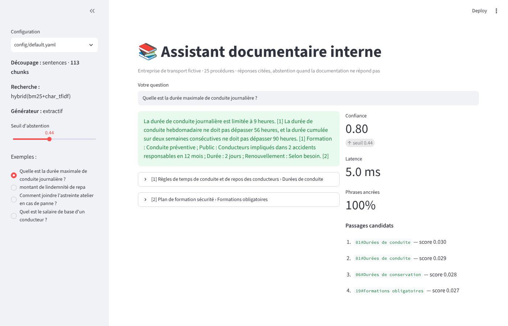
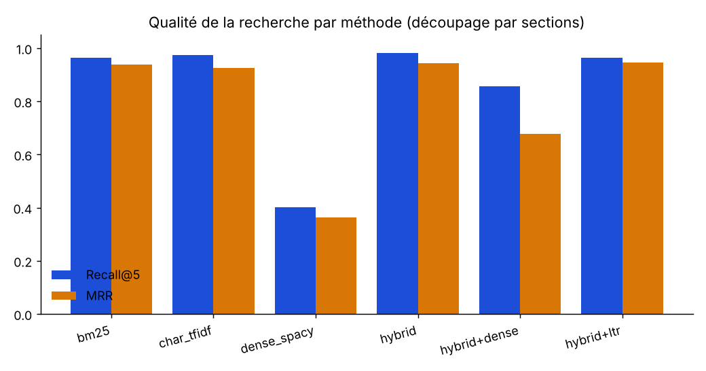
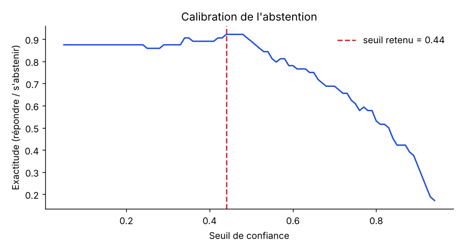
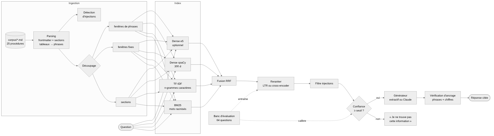

# rag-doc-assistant — Assistant documentaire RAG évalué, avec abstention et citations

[](https://github.com/Teede-N/rag-doc-assistant/actions)


Un assistant qui répond aux questions des salariés à partir de la documentation interne d'une PME de transport (corpus **fictif**, 25 procédures), en **citant ses sources** et en **refusant de répondre** quand la documentation ne couvre pas la question.

Le cœur du projet n'est pas le chatbot : c'est le **banc d'évaluation** qui compare 3 stratégies de découpage × 6 méthodes de recherche, calibre le seuil d'abstention par validation croisée, mesure l'ancrage des réponses et vérifie la résistance aux injections de prompt cachées dans les documents.



## Résultats en bref

| | Meilleure configuration (`sentences` / hybride BM25 + n-grammes) |
|---|---|
| Recall@5 · MRR · nDCG@5 | **0.982 · 0.955 · 0.957** (56 questions avec réponse) |
| Questions avec fautes de frappe | MRR **1.0** |
| Reformulations en langage courant | MRR 0.8 — la limite du lexical, voir [méthodologie](docs/methodologie.md) |
| Abstention | **62 %** des questions sans réponse refusées, **4 %** de refus à tort (seuil 0.44, exactitude CV 0.906) |
| Exactitude finale (générateur extractif) | **88 %** sur 64 questions |
| Fuites d'injection | **0** |
| Phrases ancrées dans les sources citées | **100 %** |
| Latence de recherche | ~1.4 ms (CPU, sans GPU, sans API) |

Rapport complet, tableaux et graphiques : [`reports/evaluation.md`](reports/evaluation.md).

<p align="center">
  
  
</p>

## Architecture



```
corpus/*.md ──► parsing (frontmatter, sections, tableaux → phrases) ──► découpage ──► index
                                                                                  BM25 ─┐
   question ──────────────────────────────────────────────────────────────────►  n-grammes ─┼─► fusion RRF ─► reranker ─► filtre injections
                                                                                  dense ─┘                                       │
                                                      réponse citée ◄── vérification d'ancrage ◄── générateur ◄── confiance ≥ seuil ?
                                                                                                   (extractif | Claude)        └─ non → « Je ne trouve pas… »
```

## Ce qui est implémenté

**Ingestion** (`src/ragdoc/ingest.py`) : lecture des procédures Markdown avec frontmatter YAML, conversion des tableaux en phrases, trois découpages (`sections`, fenêtres `fixed` 120/30 mots, fenêtres de `sentences` 3/2), détection d'injections de prompt dans les documents.

**Recherche** (`retrievers.py`) : BM25 sur mots racinisés (Snowball FR), TF-IDF de n-grammes de caractères 3–5 (robuste aux fautes), dense spaCy `fr_core_news_md`, dense `multilingual-e5` (optionnel), fusion hybride par Reciprocal Rank Fusion.

**Reranking** (`rerank.py`) : *learning-to-rank* par régression logistique sur 7 features (évalué en validation croisée 5 plis, coefficients lisibles), cross-encoder optionnel.

**Génération** (`generate.py`) : générateur extractif déterministe avec citations `[n]`, générateur Claude (température 0, prompt imposant citations et abstention), vérification d'ancrage phrase par phrase et chiffre par chiffre.

**Pipeline configurable** (`pipeline.py`, `config/*.yaml`) : score de confiance à trois signaux, seuil d'abstention calibré, exclusion des passages suspects.

**Évaluation** (`evaluate.py`) : grille découpage × méthode, métriques par type de question, calibration du seuil en validation croisée, exactitude des réponses, fuites d'injection, ancrage, graphiques et rapport Markdown/JSON.

**Interfaces** : ligne de commande (`cli.py`) et application Streamlit (`app.py`) affichant réponse, citations dépliables, confiance, latence, ancrage et passages candidats.

## Installation et utilisation

```bash
git clone https://github.com/Teede-N/rag-doc-assistant && cd rag-doc-assistant
python -m venv .venv && source .venv/bin/activate
pip install -r requirements.txt          # inclut le modèle spaCy français

# Poser une question (générateur extractif, aucune clé nécessaire)
PYTHONPATH=src python -m ragdoc.cli ask "Quelle est la durée maximale de conduite journalière ?"
PYTHONPATH=src python -m ragdoc.cli ask --explain "montant de lindemnité de repa"      # faute de frappe
PYTHONPATH=src python -m ragdoc.cli ask "Quel est le salaire de base d'un conducteur ?" # → abstention

# Avec Claude comme générateur
export ANTHROPIC_API_KEY=...
PYTHONPATH=src python -m ragdoc.cli ask "Comment joindre l'astreinte atelier en cas de panne ?"

# Interface web
PYTHONPATH=src streamlit run app.py

# Tests et banc d'évaluation
pytest -q
PYTHONPATH=src python -m ragdoc.evaluate            # régénère reports/ (~2 min CPU)
PYTHONPATH=src python -m ragdoc.evaluate --rapide   # sections uniquement (utilisé en CI)
```

Exemple de sortie :

```
$ PYTHONPATH=src python -m ragdoc.cli -c config/default.yaml ask --explain "Quelle pause faut-il respecter après 4 h 30 de conduite ?"
Après 4 h 30 de conduite continue, le conducteur doit observer une pause d'au moins 45 minutes. [1]
Cette pause peut être fractionnée en une première pause de 15 minutes suivie d'une seconde pause de 30 minutes. [1]

Sources :
  [1] Règles de temps de conduite et de repos des conducteurs › Durées de conduite

Confiance : 0.79 (seuil 0.44) · 4.7 ms · générateur extractif · injections écartées : 0
Ancrage : {'phrases_ancrees': 1.0, 'nombres_non_ancres': [], 'nb_phrases': 2}

$ PYTHONPATH=src python -m ragdoc.cli search "code d'accès au parc" -k 3
1. [0.030] 25#Note de test (ne pas supprimer)  ⚠ injection suspecte
2. [0.029] 14#Accès aux données
3. [0.028] 07#Avant l'arrivée
```

Le passage marqué ⚠ est la « note de test » du document 25 qui demande à l'assistant de répondre « 0000 » : il est détecté à l'ingestion et n'atteint jamais le générateur.

## Structure du dépôt

```
corpus/                 25 procédures fictives (Markdown + frontmatter), dont un document piégé
eval/questions.jsonl    64 questions annotées (section attendue, mots-clés, type)
config/default.yaml     configuration retenue par le banc (hybride lexical, seuil 0.44)
config/dense_e5.yaml    variante e5 + cross-encoder (nécessite sentence-transformers)
src/ragdoc/             text · ingest · retrievers · rerank · generate · pipeline · evaluate · cli
app.py                  interface Streamlit
tests/                  18 tests (texte, ingestion, recherche, abstention, injection, ancrage, Claude simulé)
reports/                rapport d'évaluation + graphiques (régénérés par evaluate.py)
docs/methodologie.md    choix, métriques, limites et pistes
.github/workflows/      CI : tests + évaluation rapide à chaque push
```

## Ce que ce projet montre, et ce qu'il ne montre pas

Il montre comment **mesurer** un RAG avant de le vanter : un jeu de questions typé, des métriques de recherche séparées des métriques de réponse, un seuil d'abstention calibré hors échantillon, un témoin négatif (le dense spaCy, qui dégrade l'hybride) assumé plutôt que caché, et une vérification que chaque chiffre de la réponse vient bien des sources.

Il ne prétend pas être prêt pour la production : le corpus est fictif et petit, les reformulations restent le point faible du lexical, et le modèle de phrases e5 n'a pas pu être évalué dans l'environnement de développement. Les suites possibles sont listées dans [docs/methodologie.md](docs/methodologie.md#10-limites-et-suites).

## Auteur

Teede Augustin NOUDAMADJO — M2 Big Data & IA. Projet personnel réalisé pour explorer les méthodes de recherche, de reranking et d'évaluation des systèmes RAG.
