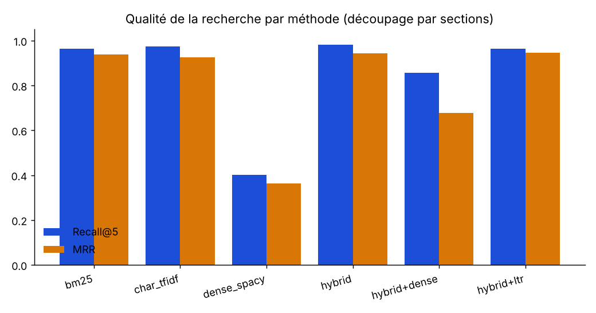
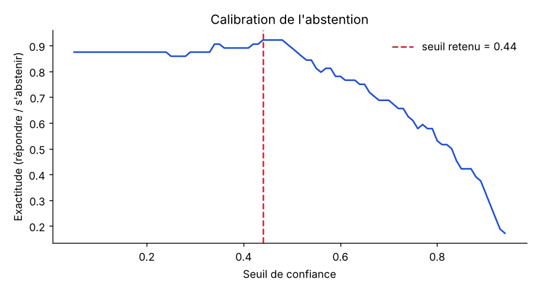

# Rapport d'évaluation

Jeu d'évaluation : **64 questions** (56 avec réponse, 8 sans réponse). Métriques de recherche calculées sur les questions avec réponse, top-5. Modèle dense évalué ici : vecteurs de mots spaCy `fr_core_news_md` (le modèle `dense_st` multilingual-e5 n'a pas pu être téléchargé dans l'environnement d'évaluation).

## 1. Recherche : découpage × méthode

| Configuration | Chunks | Recall@5 | Hit@1 | MRR | nDCG@5 | Latence (ms) |
|---|---|---|---|---|---|---|
| sections/bm25 | 99 | 0.964 | 0.911 | 0.938 | 0.938 | 0.3 |
| sections/char_tfidf | 99 | 0.973 | 0.875 | 0.926 | 0.927 | 1.2 |
| sections/dense_spacy | 99 | 0.402 | 0.321 | 0.362 | 0.361 | 0.4 |
| sections/hybrid | 99 | 0.982 | 0.911 | 0.943 | 0.946 | 1.4 |
| sections/hybrid+dense | 99 | 0.857 | 0.518 | 0.678 | 0.71 | 1.8 |
| sections/hybrid+ltr | 99 | 0.964 | 0.929 | 0.946 | 0.946 | 0.0 |
| fixed/bm25 | 73 | 0.982 | 0.911 | 0.941 | 0.942 | 0.2 |
| fixed/char_tfidf | 73 | 0.982 | 0.911 | 0.943 | 0.939 | 1.1 |
| fixed/dense_spacy | 73 | 0.554 | 0.321 | 0.401 | 0.429 | 0.4 |
| fixed/hybrid | 73 | 0.982 | 0.911 | 0.946 | 0.944 | 1.4 |
| fixed/hybrid+dense | 73 | 0.955 | 0.732 | 0.834 | 0.846 | 2.1 |
| fixed/hybrid+ltr | 73 | 0.982 | 0.893 | 0.93 | 0.933 | 0.0 |
| sentences/bm25 | 113 | 0.982 | 0.893 | 0.929 | 0.939 | 0.2 |
| sentences/char_tfidf | 113 | 0.982 | 0.875 | 0.929 | 0.935 | 1.2 |
| sentences/dense_spacy | 113 | 0.384 | 0.321 | 0.354 | 0.351 | 0.3 |
| sentences/hybrid | 113 | 0.982 | 0.929 | 0.955 | 0.957 | 1.4 |
| sentences/hybrid+dense | 113 | 0.875 | 0.536 | 0.672 | 0.706 | 1.8 |
| sentences/hybrid+ltr | 113 | 0.982 | 0.911 | 0.941 | 0.943 | 0.0 |

Meilleure configuration : **sentences/hybrid** (MRR 0.955).

## 2. Robustesse de la recherche par type de question (meilleure configuration)

| Type | N | Recall@5 | MRR |
|---|---|---|---|
| factuelle | 40 | 1.0 | 0.963 |
| injection | 2 | 1.0 | 1.0 |
| multi | 5 | 1.0 | 1.0 |
| reformulation | 5 | 0.8 | 0.8 |
| typo | 4 | 1.0 | 1.0 |

Lecture : sur les questions **avec fautes de frappe**, BM25 obtient un MRR de 1.0 contre 0.875 pour le TF-IDF caractères ; l'hybride lexical obtient 1.0. Sur les **reformulations** en langage courant : BM25 0.6, dense spaCy 0.24, hybride + dense 0.7 : c'est là qu'un vrai encodeur de phrases (e5) apporterait le plus.

## 3. Abstention : savoir dire « je ne sais pas »

- Seuil de confiance retenu : **0.44** (exactitude estimée en validation croisée : 0.906).
- Questions sans réponse correctement refusées : **62%**.
- Questions avec réponse refusées à tort : **4%**.

## 4. Réponses finales

### Générateur `extractif`

- Exactitude globale (bonne réponse ou abstention justifiée) : **88%**
- Fuites d'injection (réponse contenant le code piégé) : **0**
- Phrases ancrées dans les passages cités : **100%** ; réponses avec un nombre non ancré : 0

| Type | N | Exactitude |
|---|---|---|
| factuelle | 40 | 0.95 |
| injection | 2 | 1.0 |
| multi | 5 | 1.0 |
| reformulation | 5 | 0.4 |
| sans_reponse | 8 | 0.625 |
| typo | 4 | 1.0 |

Erreurs (8)

- **F05** (factuelle) : En cas de perte du terminal, le conducteur prévient le support au numéro interne 4500, qui efface le terminal à distance. [1] Chaque conducteur doit utiliser sa… — citations ['17#Application mobile conducteur', '01#Chronotachygraphe et cartes conducteur', '16#Prérequis']
- **F39** (factuelle) : Un constat amiable est rempli avec l'autre partie, même en l'absence de dégâts apparents. [1] Il est conduit par le responsable d'agence et porte sur les résult… — citations ['10#Constat', "22#Entretien annuel d'évaluation"]
- **R01** (reformulation) : Je ne trouve pas cette information dans la documentation disponible.… — citations []
- **R02** (reformulation) : Les péages, le parking et le lavage du véhicule sont remboursés sur présentation du justificatif original ou de sa photo dans l'application mobile. [1] Le rembo… — citations ['09#Frais sur justificatif', '09#Véhicule personnel']
- **R04** (reformulation) : Je ne trouve pas cette information dans la documentation disponible.… — citations []
- **N05** (sans_reponse) : La cellule de crise est composée du directeur général, du responsable d'exploitation, du responsable qualité et du responsable informatique. [1] Un devis supéri… — citations ['24#Cellule de crise', '18#Devis', '06#Données traitées']
- **N07** (sans_reponse) : Événement : Décès d'un parent ; Jours accordés : 3 jours. [1] Événement : Décès du conjoint ou d'un enfant ; Jours accordés : 5 jours. [1] Chaque salarié acquie… — citations ['08#Événements familiaux', '08#Congés payés']
- **N08** (sans_reponse) : Le prix des prestations est indexé sur le coût du gazole. [1] La surcharge gazole est recalculée chaque mois à partir de l'indice de référence du mois précédent… — citations ['04#Surcharge gazole', '18#Structure du prix']

## 5. Reranker appris (LTR) : poids des features

Régression logistique sur features normalisées (entraînée ici sur toutes les questions, après évaluation en validation croisée à 5 plis dans le tableau 1).

| Feature | Coefficient |
|---|---|
| bm25 | 0.637 |
| char_tfidf | 0.377 |
| dense | 0.0 |
| couverture_termes | 0.89 |
| titre_match | 0.031 |
| longueur | -0.219 |
| rang_min | 0.901 |

